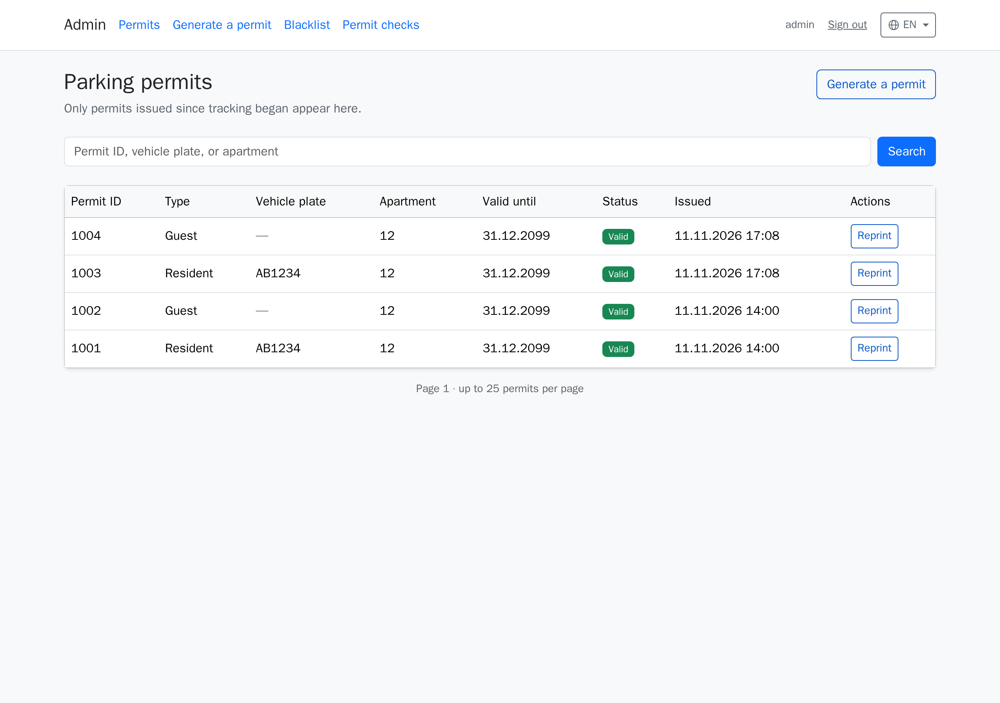
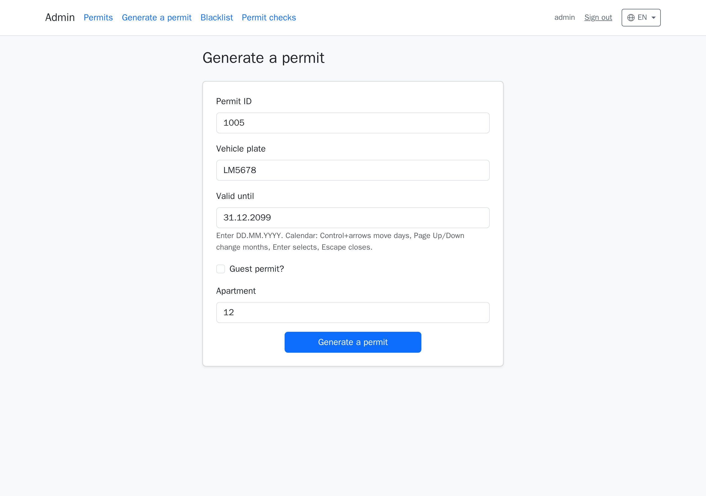
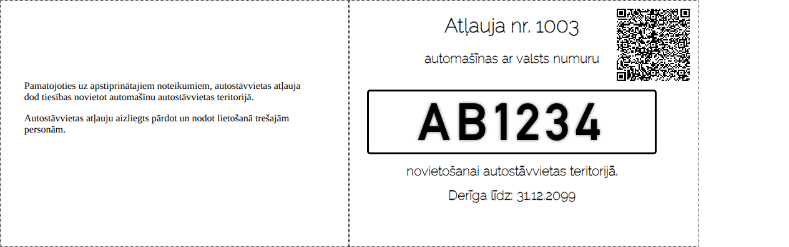
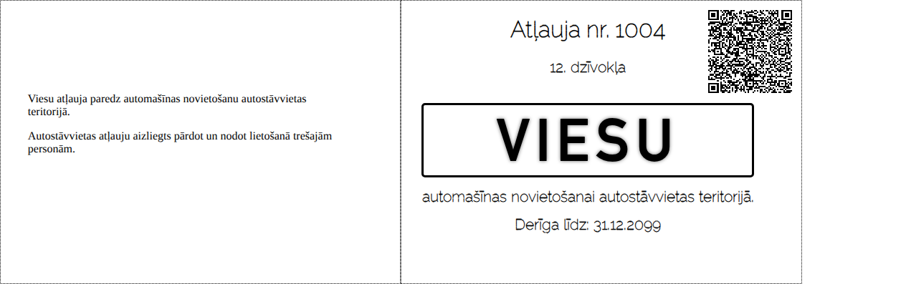
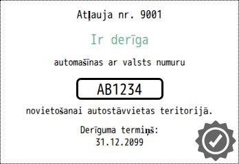
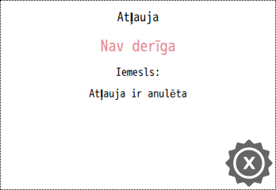

# Synthetic demonstration and review

[Project overview](../README.md)

The demo and browser suite use an extracted production archive, disposable MySQL
storage, neutral public wording, and synthetic credentials/permits. They do not
mount the development database, `.env`, or private deployment overrides. All
Node/npm, browser, lint, and PDF tools run inside Docker.

## Prepare the release

Complete the [development setup](getting-started.md), then build the runtime archive:

```sh
make release
```

The normal Docker/Composer environment is needed to build it. The demo does not
require initializing or resetting the development database. `dist/` contains the
archive and SHA-256 checksum; every demo/test verifies the checksum before extraction.

## A short interactive walkthrough

```sh
make demo
```

Open [localhost:18080/admin](http://localhost:18080/admin) and sign in with
`admin` / `test-password`. These credentials are public synthetic fixtures for
this disposable localhost environment. The port binds only to `127.0.0.1`;
override it with `DEMO_HTTP_PORT=18081 make demo` if needed. Stop with **Ctrl+C**
to remove the containers, database, and extracted files. Restarting creates a
fresh demonstration.

| Fixture | Purpose |
| --- | --- |
| `1001` | Tracked legacy resident permit, plate `AB1234`, apartment `12` |
| `1002` | Tracked version 2 guest permit for apartment `12` |
| `9001`, `9002` | Unrecorded legacy resident/guest codes |
| `9003` | Revoked legacy code |
| `9004` | Expired legacy code |

All valid fixture terms end on `31.12.2099`. Seed timestamps are fixed demonstration
values; newly generated records use the application's real clock. No production
IDs, addresses, wording, passwords, or signing keys are imported.

1. Open the legacy verification links printed in the terminal. The unrecorded
   resident/guest codes still verify, while revoked/expired codes fail. Public
   pages remain Latvian. Searching for `9001` in the admin permit list finds no
   issuance record: compatibility does not require an import.
2. Generate a resident permit with ID `1005`, plate `LM5678`, apartment `12`, and
   term `31.12.2099`. Generate another with the guest checkbox selected to compare
   the print design. New QR URLs contain `v=2`; demo targets use the localhost origin.
3. Open **Permits** and **Reprint** a valid row. Its stored version, claims, and
   issue time remain unchanged. Reprinting adds no issuance row.
4. Add the permit's exact ID under **Blacklist**, check its existing QR URL again,
   then remove the entry and recheck. The result changes immediately. Review the
   requests under **Permit checks**.
5. Switch between English, Latvian, and Russian, try the datepicker, then sign out.
   Protected pages return to login; public checks continue without authentication.

The demo exposes no worker/broker service and does not configure a scheduled job.
Audit inspection and operational limits are described in [operations](operations.md).

## Automated review

```sh
make check
make test-mysql
make infection
make release
make release-smoke
make test-browser
```

The last command uses a fresh temporary database with no host ports. The browser
origin is fixed to the internal PHP service, and signed test targets use the
reserved `https://example.com` origin. Tests verify its payload locally rather
than contacting that domain. They cannot be redirected to a production service
through a base-URL option.

The six Chromium scenarios cover login/logout, all three admin languages and
remembered selection, the calendar/mobile navigation, resident/guest generation,
both reprint versions, blacklist changes, check history, unrecorded legacy codes,
tampering, expiry/revocation, CSRF rejection, private files, and security headers.
Every scenario rejects external browser requests, JavaScript/console errors,
and CSP violations.

jsQR independently decodes the **rendered image pixels**, rather than trusting
the image's alt text or reusing the PHP encoder. Resident and guest print tests
also generate a PDF, rasterize it with Poppler, and decode its QR again. They
check 148 × 105 mm panels, fonts, hidden admin controls, and the QR's 35 mm size.
PDF evidence uses an A3 page to fit both unchanged panels without scaling;
the application print CSS and the user's printer settings are not changed.
Physical printer/scanner acceptance still needs a real-device check.

Screenshots run in a digest-pinned Linux amd64 Playwright image with matching
locked npm packages. The advancing browser clock starts at a fixed date for
calendar stability; it keeps animations running. Production PHP's clock is unchanged.
No host Node/npm installation is required or used by the Make targets.

Results are in `.phpunit.cache/browser/`: an HTML report, JSON results, PDFs,
screenshots, and traces for failed tests. View the report through Docker:

```sh
make browser-report
```

Open [localhost:9323](http://localhost:9323); stop the report server with Ctrl+C.
CI uploads the synthetic browser evidence alongside the existing quality reports
and gates release upload on a passing browser run. The first hosted CI run occurs
after the workflow is pushed; local results are not a claim that it has run there.

## Updating tools and visual evidence

The browser run includes [admin accessibility verification](accessibility.md).
Per-state axe JSON and desktop/mobile calendar captures are available in the same
report. Review incomplete findings and the manual release checklist alongside the
passing automated results.

`tests/Browser/package-lock.json` pins the test tools. To update them, edit
`package.json`, review official releases/advisories, and use `make browser-lock`.
That command runs npm in Docker using the image reference from the browser
Dockerfile. Keep the Playwright package, image version/digest, and lockfile aligned.
`make browser-check` validates declared, locked, and installed tool versions,
toolchain tests, formatting, and dependency audit. Rebuild through
`make test-browser` for full browser/print verification. See
[dependency maintenance](dependencies.md) for update proposals and CI acceptance.
Use `make browser-format` for source formatting after the tool image is built.

The committed print and public screenshots are regression baselines. Normal runs
do not create or update missing baselines. For an intentional visual change:

```sh
make test-browser ARGS='--update-snapshots=all'
```

Review every image diff, then run `make test-browser` without the update flag.
Do not accept snapshots merely to silence a regression. `make demo-capture` runs
the suite and refreshes the illustrative admin screenshots; their issuance times
reflect that run. Keep all screenshots synthetic.

## Screenshots

These captures show the shared neutral UI. Private production wording/design
overrides are deliberately excluded.













For a discussion of the choices behind the implementation, see the
[architecture decisions](architecture-decisions.md).
