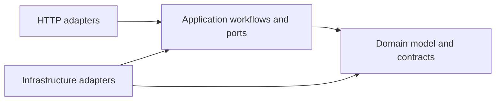

# Development

[Project overview](../README.md)

## PhpStorm debugging

The Docker development image includes Xdebug 3.5.3 (PHP 8.5 compatible). Its modes
are off by default; the separate production `runtime` target has no Xdebug.
PCOV remains the coverage driver. Enable step debugging in your local `.env`:

```dotenv
XDEBUG_MODE=debug
```

Run `make up` to rebuild/recreate PHP, then verify the extension with
`make php ARGS='--ri xdebug'`. Changing `.env` requires container recreation;
`make restart` alone does not apply environment changes. For a temporary session,
`XDEBUG_MODE=debug make up` enables it without editing `.env`.

In PhpStorm:

1. Under **Settings → PHP**, select the Docker Compose interpreter using
   `compose.yaml`, service `php`, executable `php`. For this local stack, select
   **Connect to existing container** after `make up`. Creating a new container
   also works. Refresh the interpreter information to detect Xdebug.
2. Under **PHP → Debug**, enable external connections and use Xdebug port `9003`.
3. Under **PHP → Servers**, add a server named `permit-manager` (matching
   `PHP_IDE_CONFIG`), host `localhost`, port `8080` (or your `APP_HTTP_PORT`), and
   debugger **Xdebug**. Enable path mappings: the project root maps to
   `/var/www/html` in Docker.
4. Turn on **Run → Start Listening for PHP Debug Connections** and set a
   breakpoint in `public/index.php` or a controller. Open
   `http://localhost:8080/?XDEBUG_TRIGGER=1`, or use an Xdebug browser extension
   to send the trigger cookie across requests. Select this interpreter when
   debugging PHPUnit or PHP scripts from the IDE.

Xdebug connects from Docker to PhpStorm at `host.docker.internal:9003`.
Compose supplies the Linux host-gateway mapping. Allow that connection through
your host firewall if necessary; no Docker port mapping for `9003` is needed.
For a CLI debugging session:

```sh
docker compose exec -e XDEBUG_MODE=debug -e XDEBUG_TRIGGER=1 php php bin/console.php list
```

Set `XDEBUG_MODE=off` and run `make up` again before coverage/mutation runs.
Debugging uses triggers, so ordinary web requests do not start debug sessions.
The Xdebug settings are in [docker/xdebug.ini](../docker/xdebug.ini); installation
and mode details are documented by [Xdebug](https://xdebug.org/docs/step_debug)
and [PhpStorm](https://www.jetbrains.com/help/phpstorm/configuring-xdebug.html).

## Architecture

The application uses domain rules, application use cases, and infrastructure/HTTP
adapters with dependency inversion. Services are concrete; interfaces describe
persistence and external capabilities required by the core. Project-defined
interfaces end in `Interface`, and exception classes end in `Exception`.

| Path | Responsibility |
| --- | --- |
| `src/Domain/Permit/Model/` | Immutable permit claims and normalized blacklist entry data |
| `src/Domain/Permit/Service/` | Signing, complete verification, and expiry parsing |
| `src/Domain/Permit/Validator/` | Issuance and blacklist input validation with typed failures |
| `src/Domain/Permit/Enum/`, `Exception/`, `Port/` | Domain statuses/reasons, typed failures, and persistence contracts |
| `src/Application/Command/` | Immutable write messages and synchronous handlers for issuance, blacklist changes, request-history recording, and bounded history maintenance |
| `src/Application/Query/` | Immutable read messages and synchronous handlers for verification, reprinting, and admin listings |
| `src/Application/Support/` | Shared printable-result construction and pagination, without persistence writes |
| `src/Application/Audit/` | Typed audit entry construction using the injected clock and audit port |
| `src/Application/Authentication/` | Credentials, sessions, login/logout, and throttling |
| `src/Application/Validator/` | Maintenance command limits, independent of HTTP/CLI input |
| `src/Application/Configuration/` | Typed application settings |
| `src/Application/Enum/`, `Exception/` | Application outcome codes and typed failures |
| `src/Application/Port/` | Application contracts for queries, session/attempt storage, audit persistence, settings, and QR encoding |
| `src/Application/View/` | Immutable printable results, paginated projections, history records, and authentication results |
| `src/Console/Command/` | Symfony Console adapters calling application commands |
| `src/Http/Controller/` | Public site and permit-check controllers |
| `src/Http/Controller/Admin/` | Separate authentication, generation, permits/reprints, blacklist, and check-history controllers |
| `src/Http/Middleware/` | Admin session initialization, protected-route authentication, and permit-check history capture |
| `src/Http/Request/` | Permit input parsing, per-request outcome context, and request validators |
| `src/Http/Response/` | Twig/admin/print rendering and safe HTTP error responses |
| `src/Http/Session/` | Request session access and admin session cookie construction |
| `src/Http/Translation/` | Admin language selection and admin/public Twig translation extensions |
| `src/Infrastructure/Persistence/` | DBAL repositories, query/retention adapters, and local reset implementation |
| `src/Infrastructure/Maintenance/` | Nonblocking filesystem lock for maintenance |
| `src/Infrastructure/Clock/`, `Logging/`, `QrCode/` | System clock, logger factory, and local SVG QR encoding |
| `config/`, `bootstrap/`, entry points | Construct concrete implementations and bind interfaces through PHP-DI |
| `migrations/`, `bin/reset-db.php` | Explicit schema and local initialization/reset tooling |
| `tests/Unit/{Application,Domain,Http,Infrastructure}/` | Isolated behavior grouped by the layer under test |
| `tests/Functional/`, `tests/Support/`, `tests/Fixtures/` | Slim/DI/database integration, test utilities, and synthetic fixtures |

The core dependencies point toward domain/application contracts. Domain code has
no database/framework dependencies. Application code has no infrastructure or
HTTP dependencies. HTTP classes call application workflows and consume typed
results; they do not call persistence adapters or domain services directly.
Domain values/enums/exceptions remain available to HTTP for input and display
mapping. Infrastructure implements core contracts and has no presentation
responsibilities. Configuration/bootstrap may construct all layers. Each class namespace follows
its directory beneath the existing `App\` PSR-4 prefix. Commands, queries, ports,
projections, shared support, and persistence adapters keep their existing folders;
authentication, settings, enums, exceptions, and infrastructure services have
explicit responsibility groups. The reorganization does not change service
ownership, URLs, database tables, or serialized enum values.



`config/container.php` binds domain and application ports to their concrete
adapters. Constructor dependencies put primary collaborators first, supporting
services/configuration next, and the logger last. Application services never
resolve their own dependencies. A repository can implement several small
contracts: for example,
`BlacklistRepository` serves domain revocation lookup, application management,
and listing queries. Application/HTTP classes do not resolve the container.

PSR-3 logging and PSR-20 clocks are injected into application services. HTTP uses
PSR-7 messages, PSR-17 factories, and PSR-15 middleware; PHP-DI implements PSR-11.
Symfony Translation and Twig stay in presentation/configuration. Unit tests
substitute core ports and use a fixed clock without constructing a database.

## Core workflows

Application use cases use CQRS with direct constructor injection: each concrete
handler exposes `handle()` for one immutable `final readonly` command or query.
HTTP adapters construct these messages from parsed input. There is no command
bus, event system, asynchronous projection, or separate read database.

| Command | Result / responsibility |
| --- | --- |
| `GeneratePermitCommand` | Validate and save issuance; return `PrintablePermit` synchronously |
| `AddBlacklistedIdCommand` | Validate and add an exact ID; report duplicates without replacing their reason |
| `RemoveBlacklistedIdCommand` | Validate and remove an exact ID idempotently |
| `RecordPermitCheckCommand` | Store bounded request metadata with the existing best-effort failure policy |

| Query | Result |
| --- | --- |
| `ListPermitsQuery` | `Page<PermitListItem>` with current display status |
| `ListBlacklistQuery` | `Page<BlacklistItem>` |
| `ListPermitChecksQuery` | `Page<PermitCheckRecord>` with optional outcome filtering |
| `VerifyPermitQuery` | Nullable domain `PermitFailureReason` |
| `ReprintPermitQuery` | Existing `PrintablePermit`, without saving issuance data |

Each message has a corresponding concrete handler, for example
`GeneratePermitHandler` and `ListPermitsHandler`. Query handlers receive read
ports only; command handlers receive the write capabilities required by their
operation. Both use the same database and may share a concrete storage adapter.
`PermitRepositoryInterface` exposes issuance writes, while the application-owned
`PermitLookupInterface` exposes fingerprint lookup for reprinting.

`GeneratePermitHandler` normalizes issuance input, invokes `PermitIssuanceValidator`,
saves through the domain repository, and returns the permit, signed URL, and
local QR data URI. `ReprintPermitHandler` loads the exact stored permit and
rechecks its validity using the current blacklist and clock. HTTP maps missing
records and rejected reprints to the existing 404/403 responses.
`PrintablePermitFactory` shares signed-URL/QR construction without storage
access; handlers do not call other handlers to share behavior. Operational logs
remain in the relevant handlers and contain no new request secrets.

`PermitSignatureVersion` distinguishes legacy MD5 (`1`) from HMAC-SHA-256 (`2`).
`GeneratePermitHandler` always selects version 2, independently of submitted input.
`PermitInput` treats missing/empty `v` as legacy, accepts explicit `1` or `2`, and
rejects other values. `PermitSigner` uses separate keys and an unambiguous
length-prefixed payload for version 2, without falling back to legacy verification.
Persistence restores the enum for lookups and list projections, so reprints retain
their original format. See the [wire format](database.md#signature-versions).

`PermitVerifier` owns complete verification. It queries
`PermitBlacklistInterface` before expiration/signature checks. `PermitExpiration`
provides common date parsing for verification, issuance, and list status.
`InvalidPermitInputException` carries a `PermitFailureReason` enum; controllers
never interpret exception messages or expose them to visitors.

`AddBlacklistedIdHandler` and `RemoveBlacklistedIdHandler` invoke
`BlacklistEntryValidator` on the raw ID and reason before constructing a normalized
`BlacklistEntry`, and log changes using ID hashes. Listing handlers use
typed query projections and the shared `Pagination` helper: 25 displayed rows
with a 26-row look-ahead. Permit listing uses one bulk revocation lookup.
Listing status reflects recorded expiry and current revocation; public
verification additionally checks the supplied signature.

Models carry data and normalization; concrete validators own issuance and
blacklist input rules. `PermitIssuanceValidator::validate()` returns the parsed
end-of-day expiration in the configured timezone. It does not add a rule against
issuing historical dates. `PermitIdValidator` supplies the shared non-whitespace,
255-byte, and ASCII control-character policy to the issuance and blacklist
validators through constructor DI. Both preserve the exact accepted ID.
Verification still accepts raw claims and uses
`PermitVerifier` independently, preserving rejection priority.
`BlacklistEntryValidator` checks byte limits before blank reasons become `null`,
so oversized whitespace reasons remain invalid. Domain validators have no I/O
capabilities. They are injected into command handlers through the container.
`CsrfTokenValidator` owns the HTTP token comparison, safe warning, and forbidden
response; it is injected into controllers handling state-changing admin requests. HTTP structure parsing,
configuration checks, authentication, and verification keep their boundary-specific
responsibilities.

`AuthenticationService`, `AdminSessionService`, and `LoginRateLimiter` own login,
logout, session expiry/rotation, credential changes, and failure-window policy.
HTTP adapters handle cookies and CSRF. SQL adapters store session tokens as
hashes and persist counters using address hashes.

`PermitCheckMiddleware` extracts HTTP metadata and optional submitted expiry and
apartment fields, then passes them to the application
`RecordPermitCheckCommand` through `RecordPermitCheckHandler`, separately from
the verification query. The recording handler applies the retention-field
bounds and best-effort logging policy; its storage adapter serializes enums and UTC dates.
The listing query combines those snapshots with the current blacklist in one
bulk lookup. History actions use the existing add/remove command handlers,
CSRF protection, audited transactions, signed feedback, and confirmation dialog.
Read handlers may consult pure domain validators to determine which actions are
available; write ports and command handlers remain forbidden query dependencies.
It does not require permit settings or credentials, so failures constructing the
verification controller can still produce history records while storage works.

Repositories serialize enum values as stable string codes. Translations and HTML
remain outside the domain/application layers. Public/printed templates continue
to receive `permit`, `reason`, `qrtext`, and `qrimage` where applicable; admin
lists consume the typed projections in `Application\View`.

## Architecture checks

[Deptrac](https://deptrac.github.io/deptrac/) enforces the layer rules in
`deptrac.yaml`. The check rejects forbidden class/type dependencies, uncovered
dependencies, and unassigned project classes. Domain services/contracts are
classified separately from domain values so HTTP cannot bypass application
workflows by injecting domain repositories or verification services. PHP runtime
classes are allowed; external library contracts are explicitly classified.
Command/query messages, handlers, read/write ports, authentication services, and
shared support have separate rules. Query handlers cannot depend on command
handlers, write ports, or authentication/session services. Printing/pagination
support cannot depend on persistence ports, preventing hidden writes through
shared helpers.

```sh
make architecture
```

This also runs as part of `make check`. There is no skipped-violation baseline.
Keep new classes within the existing layers and update the rules deliberately
when introducing a new dependency. The root architecture configuration and cache
are blocked over HTTP; the cache is excluded from Git and Docker build contexts.

## Admin HTTP responsibilities

Admin controllers inject only the handlers and HTTP collaborators needed by their
pages. `AuthenticationController` handles the entry redirect, login, and logout;
`PermitGenerationController` handles issuance; `PermitController` handles issued
permit listings and reprints; `BlacklistController` handles blacklist management;
and `PermitCheckController` handles history listings and their blacklist actions. The former mixed
`AdminController` is removed.

`AdminSessionMiddleware` establishes the request's session before the protected
route group's `AdminAuthenticationMiddleware` runs. Anonymous access to protected
GET/HEAD/POST routes redirects to `/admin/login`; the admin entry and login routes
remain available without authentication. Controllers still require CSRF
validation for state-changing requests.

`AdminSessionAccessor` retrieves the typed session attribute and reports missing
session middleware. `PaginationInputValidator` preserves the shared 200-byte
search limit and page range of 1–100,000. `AdminRenderer` supplies the existing
username/language context, writes HTML responses, and maps printable permits to
their existing template fields. These concrete collaborators use constructor DI;
controllers do not inherit a shared base or resolve the container.

## Routes and compatibility

| Route                                          | Behavior                                                       |
|------------------------------------------------|----------------------------------------------------------------|
| `GET /`                                        | Configurable landing page                                      |
| `GET /health`                                  | JSON liveness response                                         |
| `GET /p/check`, `GET /p/check.php`             | Public permit verification                                     |
| `GET /permit`, `/permit/`, `/permit/index.php` | 303 redirect to the authenticated generator                    |
| `/admin/*`                                     | Admin routes described in the [admin guide](administration.md) |

GET routes also support HEAD. POST requests to the old generator URLs are
rejected; generation POSTs go to `/admin/permits/generate` with authentication and
CSRF protection. `POST /admin/permits/{fingerprint}/reprint` prints an existing
valid record, also requiring authentication and CSRF protection. It uses stored
permit details and writes no issuance data. The legacy URLs are Slim routes, not old PHP entry-point files.
Apache rewriting preserves them while static assets retain their existing URLs.
Apache may first canonicalize `/permit` to `/permit/` with a 301 redirect.

Verification query parameters:

| Parameter | Resident                   | Guest                      |
|-----------|----------------------------|----------------------------|
| `id`      | Permit ID                  | Permit ID                  |
| `plate`   | Vehicle plate              | Not required               |
| `guest`   | Omitted                    | `1`                        |
| `apt`     | Not required               | Apartment                  |
| `term`    | Expiration in `dd.mm.yyyy` | Expiration in `dd.mm.yyyy` |
| `v` | Omitted/`1` for legacy; `2` for HMAC | Omitted/`1` for legacy; `2` for HMAC |
| `sign` | Signature for the selected version | Signature for the selected version |

For comparison between installations, use a real generated URL and change only the
origin. Preserve exact query values and align secrets, blacklist, timezone, and
current time. Arbitrary example signatures cannot yield valid permits. See
[compatibility rules](database.md#existing-permits).

## Quality checks

Start the development environment and install locked dependencies before running
Make targets. Most quality commands execute in the running PHP container.

| Command                             | Check                                                                  |
|-------------------------------------|------------------------------------------------------------------------|
| `make validate`                     | Composer configuration and lockfile validation                         |
| `make test`                         | Strict PHPUnit suites without collecting coverage |
| `make coverage` | Run all tests and enforce at least 95% total line coverage |
| `make test ARGS='--testsuite Unit'` | Unit suite only                                                        |
| `make test-mysql` | MySQL integration suite in disposable containers |
| `make lint-ci` | GitHub Actions workflow validation with actionlint |
| `make lint-shell` | ShellCheck for release/deployment shell scripts |
| `make release` | Build the production archive and SHA-256 checksum |
| `make release-smoke` | Test the extracted archive, cPanel layout, and file rollback |
| `make stan`                         | PHPStan level `max`, strict/deprecation/PHPUnit rules                  |
| `make psalm` | Psalm level `1`, PHP 8.5 type and security analysis, without a baseline |
| `make architecture` | Enforce layer dependencies and require assigned project classes |
| `make lint-templates`               | Twig syntax for shared and active private templates                    |
| `make cs-check`                     | PHP-CS-Fixer dry run and PHP_CodeSniffer rules |
| `make cs-fix`                       | Apply PHPCBF and PHP-CS-Fixer automatic fixes |
| `make phpcs` | Run PHP_CodeSniffer alone |
| `make phpcbf` | Apply PHP_CodeSniffer automatic fixes alone |
| `make rector`                       | Preview configured PHP upgrade refactorings                            |
| `make rector-fix`                   | Apply those refactorings                                               |
| `make audit`                        | Composer dependency security advisory check                            |
| `make infection`                    | Domain/application mutation testing                                    |
| `make check` | Standard checks with coverage; excludes MySQL tests, workflow linting, mutation testing, and fixes |

PHP-CS-Fixer applies PER-CS 3.0 and Symfony formatting, strict comparisons and
assertions, sorted imports, and unused-import checks. Its PHPUnit method-call
rule explicitly targets the newest supported PHPUnit API: invocation matchers
such as `once()`, `never()`, and `exactly()` use `$this->`, while static assertions,
constraints, and stub factories use `self::`. PHP_CodeSniffer uses
`phpcs.xml.dist` to check PSR-12, a 120-character error limit, strict types, short
arrays, interface naming, stray empty statements, merge markers, and forbidden
debug calls (`var_dump`, `print_r`, `dump`, `dd`). Warnings and errors fail the
check. Sniffer exceptions align PSR-12 with PER's compact empty bodies and the
project's alphabetically sorted imports without blank lines between import kinds.

Both tools check `src/`, `tests/` (including fixtures/support PHP), `config/`,
`translations/`, `migrations/`, `bootstrap/`, `bin/`, `public/index.php`, `rector.php`,
and `.php-cs-fixer.dist.php`. Dependencies, caches, and private deployment files
are outside the maintained style scope. `.editorconfig` provides matching UTF-8,
LF, four-space indentation, and 120-column guidance to supporting editors.

`make cs-check` runs both tools and is included in `make check`. `make cs-fix`
runs PHPCBF before PHP-CS-Fixer. Reflow long expressions, strings, comments, and
SQL manually when the automatic fixers cannot split them safely; line-length
violations remain errors. `single_line_throw` is disabled so the formatter does
not collapse a deliberately wrapped exception back into an overlong line.

Use named arguments for calls (including functions and constructors) with more
than three parameters or repeated scalar parameter types (`string`, `int`,
`float`, `bool`, including nullable variants). Apply the same rule when multiple
supplied values have the same scalar type. Leave a single supplied first argument positional; keep its
name when it skips earlier optional parameters. Keep variadic argument lists and
vendor APIs explicitly marked `@no-named-arguments` positional; PHPUnit assertion APIs use that restriction.
Style and static analysis cover maintained PHP code, including configuration,
migrations, CLI scripts, and test/support classes. Rector also checks these code
areas for upgrades matching the configured PHP version. Inspect changes from fix
commands and rerun `make check`.

PHPUnit fails on issues including warnings, deprecations, risky, skipped, and
incomplete tests. It checks output, backed-up global state, and coverage metadata.
The test bootstrap enables Doctrine deprecation reporting. PHPStan additionally
checks deprecated APIs that may not emit runtime warnings.

## Psalm and PhpStorm

Psalm is a locked development dependency installed by `make composer ARGS='install'`.
Run `make psalm` (or `make composer ARGS='psalm'`) inside the Docker environment.
Both `make check` and Composer's `check` script run it, so CI uses the same gate.
For a focused scan, use `make psalm ARGS='src/Http'`; run the full check before
committing. Keep `XDEBUG_MODE=off` for analysis and coverage runs.

[psalm.xml](../psalm.xml) uses the strictest error level, targets PHP 8.5, and
includes application code, entry points, configuration, migrations, tools, and
tests. Psalm's bundled integration detects PHPUnit and Symfony. There is no
error baseline or blanket issue suppression. Runtime-selected deployment/fixture
includes have individual `UnresolvableInclude` annotations because their paths
cannot be resolved statically; release and functional tests exercise them.
Individual `WeakHash` annotations cover the legacy signer and dynamic synthetic
fixtures that must reproduce the original MD5 signature. New permits use
HMAC-SHA-256.
Unused suppression annotations fail analysis. CLI file inputs resolve to local
paths, and the smoke-test origin is explicitly selected by its operator. The
corresponding taint annotations describe these trust boundaries; web input is
still checked. Dead-code detection is opt-in (`make psalm ARGS='--find-unused-code'`)
because routes, DI, and framework callbacks have external entry points. Analysis
caches stay in the ignored `.psalm.cache/` directory, outside the document root.

In PhpStorm:

1. Under **Settings → PHP**, select the Docker Compose interpreter for
   `compose.yaml`, service `php`. Set its lifecycle to **Connect to existing
   container** and keep the development stack running with `make up`.
2. Open **PHP → Quality Tools → Psalm**. Click **…** next to **Configuration**,
   select the Docker interpreter, and set **Psalm path** to
   `/var/www/html/vendor/bin/psalm`. Click **Validate** to check the version.
3. In the main Psalm settings, select the project's `psalm.xml` as the
   **Configuration file** and enable **Psalm inspection**. Leave **Find unused
   code** off to match the CLI configuration. The default idle run mode works;
   checks are also available through **Code → Inspect Code**.

The executable path belongs to Docker, while the configuration file chooser
selects the local project file. The interpreter maps the project root to
`/var/www/html`. See [PhpStorm's Psalm integration](https://www.jetbrains.com/help/phpstorm/using-psalm.html)
and [Psalm configuration](https://psalm.dev/docs/running_psalm/configuration/).

## Coverage requirement

`make coverage` (or `composer coverage`) runs the unit and SQLite functional suites with
PCOV enabled, generates a fresh Clover report, and invokes
`bin/check-coverage.php`. A successful PHPUnit run is required before the checker
runs. Both `make check` and `composer check` use this coverage command instead of
running the suite a second time. `make test` remains available for fast or focused
test runs without collecting coverage.

The minimum is **95% total line coverage** across the unchanged PHPUnit source
filter: `src/`, `migrations/`, and `public/index.php`. Uncovered files are explicitly
included. This is an overall line requirement; class and method percentages are
reported separately. PCOV's directory is set to the project root for this run so
migrations and the entry point are instrumented too.

The checker uses the Clover project's covered/executable statement totals and
compares integer counts, so exactly 95% passes and a value below 95% cannot pass
through percentage rounding. Missing/malformed reports, missing project metrics,
and invalid or zero line counts fail the command. The threshold is defined in
`bin/check-coverage.php`; no additional coverage package is required.

Reports are written under the Git-ignored, HTTP-blocked `.phpunit.cache/coverage/`
directory: `clover.xml` for machine-readable results and `html/index.html` for
browsing. Startup tests execute the actual `public/index.php` with temporary
bootstrap/logger fixtures selected through `APP_ROOT`, exercising its safe failure
boundary and contributing coverage for the maintained entry point.

## Test strategy

Unit tests exercise domain/application services through port doubles and a fixed
clock. Functional tests use test credentials and in-process PSR-7 requests through
Slim and the real DI container. The default database tests
use fresh in-memory SQLite connections and migration SQL. They require PDO SQLite,
already available in the development image; the tests themselves need no running
MySQL server, production secrets, network, or QR service.

The separate MySQL suite tests the actual migration CLI, initialization, migration
reruns and rollback, duplicate records, transactions, exact-ID matching despite
case/accent-insensitive collations, stable pagination, escaped search, UTF-8 data,
and session/check-history storage types.

```sh
make test-mysql
make test-mysql ARGS='--filter MigrationTest'
```

Install locked dependencies first using `make composer ARGS='install'` in the
development stack. `make test-mysql` then builds the same PHP image and starts
[compose.test.yaml](../compose.test.yaml) under a unique Compose project name.
It does not require the development services to remain running. MySQL 8.4 stores
test data in memory, publishes no ports, and shares no development database volume.
The command removes its containers, volumes, and network on success or failure.
It ignores the project's `.env` for Compose interpolation; the test endpoint and
credentials are fixed synthetic values, and migration subprocesses override all
database connection variables. Test migrations never use the application's
configured database.

[phpunit.mysql.xml.dist](../phpunit.mysql.xml.dist) keeps these tests separate
from `make test`, the 95% coverage gate, and Infection. Each MySQL test gets a fresh
migration of the disposable schema. `composer test-mysql` is the runner inside
this test environment; prefer the Make command to manage its lifecycle. Failures
are errors, not skipped tests. JUnit results are written to
`.phpunit.cache/mysql/junit.xml`.

MySQL tests do not exercise Apache rewriting. Use `make release-smoke` for
Apache-level checks and `make test-browser` for browser and print regressions.
Review the deployed Apache configuration and physical print output separately.

`make release-smoke` adds Apache-level integration checks against the extracted
production archive. It uses the Docker `runtime` target, without Composer, PCOV,
development dependencies, or the development source mount. Its database and release
workspace are disposable. It checks default and fixed `public_html` layouts,
legacy resident/guest/revoked queries, private files, asset hashes, startup errors,
and a candidate/rollback cycle preserving the database. See
[release verification](deployment.md#build-and-verify-a-release).

Infection mutates `src/Domain` and `src/Application` with both test suites. Its
configuration requires at least 95% overall and covered mutation scores, uses two
workers, and writes reports under `.infection.cache/`. PCOV is installed but
disabled by default; the Composer coverage and mutation commands enable it for
their respective runs.
Mutation testing is separate from `make check`.

Functional tests use an in-memory Monolog handler. PHP fallback diagnostics go to
`.phpunit.cache/application.log`, avoiding stderr noise during Infection's initial
coverage run. The test bootstrap creates the log directory and sets an absolute
log path, including on a fresh checkout without existing PHPUnit caches.
Test warnings and deprecations still fail the suite.

## Continuous integration

[.github/workflows/quality.yaml](../.github/workflows/quality.yaml) runs on pushes,
pull requests, merge-queue checks, manual dispatch, and Mondays at 04:23 UTC.
The quality job validates the workflow with actionlint, installs locked dependencies in the existing Docker
image, runs `make check`, checks locked browser tooling, and runs the separate
MySQL integration suite. Another job runs `make infection` on every supported event.
Either job fails when its checks fail; no gate uses `continue-on-error`.

A release job requires successful quality and mutation jobs. It checks deployment
shell scripts, builds the production-only archive, tests Apache deployment layouts and
rollback, and uploads the archive and checksum as `permit-manager-release` for
14 days. It installs dependencies only in a staging directory and does not deploy
to any external server.

Verification jobs use read-only repository permissions, do not retain checkout
credentials, and pin GitHub actions to commit SHAs. After `Required checks` succeeds
on a pushed `v*` tag, a separate publication job downloads the verified artifact
from that same run, checks its checksum, and publishes a GitHub Release. Only that
job has `contents: write` and `actions: read`; it uses the built-in `GITHUB_TOKEN`
and does not check out or execute application code. Hyphenated version tags are
prereleases. See [versioned downloads](deployment.md#downloading-builds-and-publishing-versions).
The workflow needs no configured repository secrets or production configuration.
Test fixtures supply initialization values; there is no server deployment step
and no production service dependency.

The Quality run summary shows the measured PHP line coverage after `make check`
passes. The README badges show the required minimums for line coverage and mutation
score. Coverage HTML/Clover and MySQL JUnit results are uploaded as `quality-reports`;
Infection reports are uploaded as `mutation-reports`. Available reports are
uploaded after failures too and retained for 14 days. The upload paths select
only reports, not application logs, private files, or environment configuration.
Each job cleans up its development containers; the MySQL command manages its own
isolated containers. The final `Required checks` job accepts only success from
quality, mutation, and release; failure, cancellation, skipping, or missing results
block acceptance. Configure that check in the repository's branch rules; see
[dependency maintenance and owner setup](dependencies.md).

Run the same checks locally:

```sh
make lint-ci
make check
make browser-check
make test-mysql
make infection
make lint-shell
make release
make release-smoke
make test-browser
```

`make lint-ci` runs the digest-pinned image from `docker/tools.Dockerfile`
and needs no PHP service.
The first GitHub-hosted run takes place after the workflow is pushed; scheduled
runs use the repository's default branch.

## Frontend dependencies

The browser uses committed local assets, without npm, a bundler, or CDN access at
runtime. `assets.lock.json` records every file under `public/vendor/`: its pinned
upstream HTTPS URL, version, SHA-256 checksum, and license. Bootstrap, jQuery, and
jQuery UI retain their MIT licenses; the four Google Fonts retain their OFL
licenses. Existing permit CSS, icons, and DIN plate font retain their appearance.
The legacy font/icon inventory is also hashed, with unverified rights explicitly
marked `NOASSERTION`; see the [publication review](publication.md).
Integrity verification does not establish redistribution permission.
Git line-ending conversion is disabled for both asset directories in
`.gitattributes` so committed files retain the exact bytes recorded in the manifest,
including upstream license files that use CRLF line endings.

Permit headings retain the original Raleway Dots family. The local Google Fonts
stylesheet includes the upstream Latin and Latin Extended subsets for Raleway
Dots, Audiowide, and Faster One, so Latvian letters use those fonts rather than
system fallbacks. Fugaz One retains its upstream Latin-only coverage. Font files
use the same upstream family versions; the DIN plate font and permit layout are
unchanged. The stylesheet URL has a revision query to refresh existing browsers.

Run `make assets-check` for an offline integrity check. Both `make check` and
Composer's `check` script include it; production archive creation checks it before
packaging. Missing, changed, duplicated, or unrecorded vendor files fail the check.
The manifest provides reproducibility and review evidence; its hashes do not
replace reviewing an upstream release or its security advisories.

To update a dependency:

1. Review the project's official release notes, security advisories, browser
   support, and upgrade guide. Select an explicit version; do not use `latest` URLs.
2. Download that version from its official distribution source over verified
   HTTPS. Replace the corresponding versioned directory, retaining the license and
   any theme images referenced by CSS. Bootstrap JavaScript is unused and omitted.
3. Update template URLs and the manifest entries, including checksums calculated
   from the reviewed downloaded bytes. The font CSS alone is derived: upstream
   `fonts.gstatic.com` URLs are replaced by their local basenames (`localize: true`
   in the manifest). Font binaries remain unmodified; their source URLs include
   upstream versions. License URLs use a pinned Google Fonts repository commit.
   Google Fonts CSS varies by user agent: preserve the manifest's recorded browser
   user agent and all supplied subsets/ranges when downloading its stylesheet.
   A generic-user-agent response may contain only Latin TTF files. Browser checks
   inspect the fonts actually used for Latvian glyphs, beyond checking CSS names.
4. Run `make assets-check`, `make check`, `make release`, and `make release-smoke`.
   Exercise the language selector and datepicker in English, Latvian, and Russian,
   plus login, generation, reprinting, and logout. Check the browser console for
   CSP violations and ensure the Network panel shows no third-party requests.
5. Compare public checks and resident/guest permits, including print preview,
   fonts, dimensions, and the 35 mm QR image. Commit the reviewed files, manifest,
   template changes, and any compatibility changes together.

Versioned vendor directories give library upgrades new URLs. The shared admin
script uses a revision query in both the admin base and printable-permit
templates; increment both references when its behavior changes so cached scripts
cannot mismatch new markup. Browser tests reject the former unversioned URL and
check confirmation titles and action labels in all admin languages. Other
first-party assets use ordinary HTTP validation; do not configure an immutable
cache for unversioned paths without introducing a cache-busting strategy.

Successful reprints include a dedicated, versioned `permit-print.js` module. It
waits for the page load event and `document.fonts.ready`, then calls the browser's
native `window.print()` once. Newly generated permits retain manual printing.
Browser tests intercept the native call and verify that the QR image, fonts, and
document are ready, while PDF/QR checks continue to verify the print layout.

## Maintenance and recovery verification

`make doctor` invokes `app:doctor` through the production console. Its console
adapter calls `DiagnoseDeploymentHandler` and the read-only
`DeploymentDiagnosticsQueriesInterface`. Database and configuration adapters
collect typed `DiagnosticCheck` results; their external dependencies remain in
infrastructure. The dedicated diagnostics layer may inspect Twig and Monolog
configuration, while domain/application code stays independent of those vendors.
`config/diagnostics.php` wires deferred configuration loaders through DI.

Console commands are loaded lazily. A broken logger configuration does not prevent
the doctor from reporting its failure, and console startup errors stay generic
even in verbose mode. Tests cover healthy and corrupted SQLite schemas/settings,
unavailable connections, migration mismatches, private override syntax/readability,
target permissions, and unchanged state. Isolated MySQL tests invoke the actual
CLI with no initial seed credentials and compare every table before/after. See
[diagnostic limits and exit codes](operations.md#read-only-deployment-diagnostics).

`make prune-checks` invokes the production Symfony Console entry point through
Composer and the existing PHP-DI bindings. The console adapter constructs an
immutable `PrunePermitChecksCommand`; its handler uses application ports, a
separate validator, PSR-20 clock, and PSR-3 logger. A nonblocking file-lock adapter
and a bounded DBAL deletion adapter implement those ports. HTTP behavior and
permit signing are independent of maintenance. See [operations](operations.md).

Unit and SQLite functional tests cover UTC boundaries, safe defaults, invalid
limits, bounded preview/deletion, continuation, overlapping locks, lock failures,
and release after failure. MySQL tests exercise real deletion SQL and compare
representative plans with and without the baseline indexes in the disposable
database. The CI quality artifact includes the index-review JSON next to the MySQL JUnit report.

`make release-smoke` also runs `bin/test-recovery.sh` inside the disposable release
environment. It dumps all tables, archives synthetic private wording/seed/CSS
files, checks backup hashes, imports into a fresh database, removes and restores
the private files, and compares every row and private-file hash. This includes
credentials, both signing keys, and migration history. It invalidates restored
sessions/counters, switches Apache to the restored database, runs the production
maintenance CLI, and verifies legacy/HMAC links using signatures created before
the backup. It then returns to the original test database for rollback checks.
Backups exist only in the temporary test directory and are removed on exit.
No development or production database is used. This is a restore drill; it does
not install a backup scheduler or replace a provider-specific restoration test.

## Admin transactions and failure verification

`TransactionInterface` runs a callback through the DI-bound `DatabaseTransaction`.
All state adapters and `AdminAuditTrail` use that same connection. The core depends
on the transaction/audit contracts and concrete `AdminAudit` service, with no DBAL
or HTTP dependency. Audit action codes use `AdminAuditAction`; records contain
only actor, action, target hash, and UTC time. Read handlers remain unable to
write audit entries under the architecture rules.

`PermitRepositoryInterface::save()` returns whether insertion occurred; the
unique fingerprint serializes duplicate issuance and controls its single audit
entry. `BlacklistManagementInterface::remove()` reports actual deletion to avoid
auditing no-ops. Login failure storage uses an atomic upsert with a conditional
fixed-window reset, retaining SQLite coverage and avoiding deprecated MySQL
`VALUES()` references. Expired-counter cleanup excludes the current address;
that row is reset or incremented atomically by the upsert.

Functional HTTP tests inject QR, template, logger, and audit failures, checking
private errors, rollback, committed data, and idempotent issuance retry. The
MySQL suite starts independent PHP workers with separate connections and a
readiness/start barrier, exercising duplicate issuance, competing revocations,
removals, mixed add/remove operations, and concurrent failed logins. It injects
an audit constraint failure to check real rollback, then retries successfully.
Connection-outage tests kill only their own disposable MySQL connection and
verify generic public/admin errors with private diagnostic logs. These tests
require no extra production database privileges or background service.

The release recovery drill includes audit rows in the exact backup/restore
comparison. Audit policy and the practical limits of retries and concurrency are
specified in [operations](operations.md#failure-and-retry-behavior).

## Request correlation and Sentry

HTTP request correlation uses `RequestIdMiddleware`, an application logging port,
and a scoped PSR-3 decorator. Bootstrap binds the context and decorator through
DI; the core handlers keep their PSR-3 dependencies. Scope cleanup covers returned
responses and escaping exceptions, with a native entry-point ID for early failures.

Optional Sentry reporting uses the SDK's current Monolog handlers behind a
best-effort group. Payload hooks reconstruct reduced error events and allowlist
structured log metadata. Tests use a recording in-memory transport and inspect
serialized envelopes; live delivery stays disabled in automated test environments.
See [observability](observability.md) for configuration and privacy boundaries.

## Browser and print verification

Admin verification also includes axe scans in all three languages, keyboard and
focus behavior, server-error feedback, narrow reflow, and text resizing. Complete
axe results retain findings requiring manual review. See
[accessibility scope and release checks](accessibility.md) for the WCAG target,
covered states, reports, keyboard controls, and remaining assistive-technology work.

Production defaults, template-cache warming/invalidation, dependency audit, and
the isolated `make benchmark` HTTP harness are described in
[production configuration and measurements](performance.md). Benchmark runtime
probes remain test-only and never enter the production archive. Release tests
verify warmed private overrides, cache failures, physical release namespaces,
in-place template revisions, both hosting layouts, and rollback.

`make test-browser` runs the extracted production archive with synthetic MySQL
fixtures. Playwright, Biome, npm audit, jsQR, PNG decoding, and Poppler run in the
separate Docker tool image; no Node/npm command runs on the host. The runtime
application and frontend need no Node/build tool on shared hosting.

The readiness-checked environment has no host ports and is removed on exit.
Chromium rejects external requests and reports script/console/CSP issues. Its
suite exercises authentication, generation, both reprint formats, languages,
blacklisting, legacy checks, and privacy boundaries. Screen QR pixels and
rasterized print PDFs are independently decoded; fonts, dimensions, and reviewed
public/print snapshots protect the existing presentation. The font regression test
checks each supported Latvian letter's rendered font in Chromium and extracts
Latvian text from a PDF with embedded fonts. Baseline updates require
an explicit flag. CI gates release upload on this suite and retains evidence.

`make demo` uses a separate localhost-only port and disposable data for interactive
review. See [the walkthrough](demo.md) for fixtures, reports, screenshots, tool
updates, limits, and exact commands. See [architecture decisions](architecture-decisions.md)
for the implemented design choices and their consequences.
